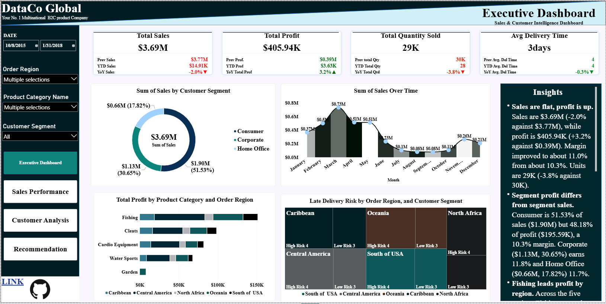
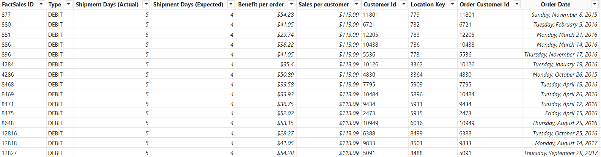
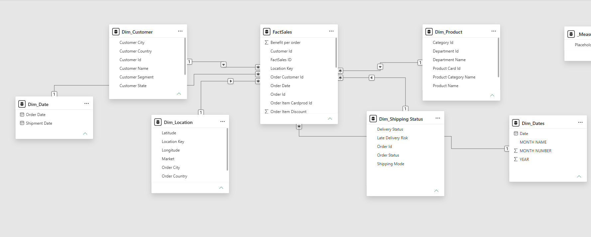
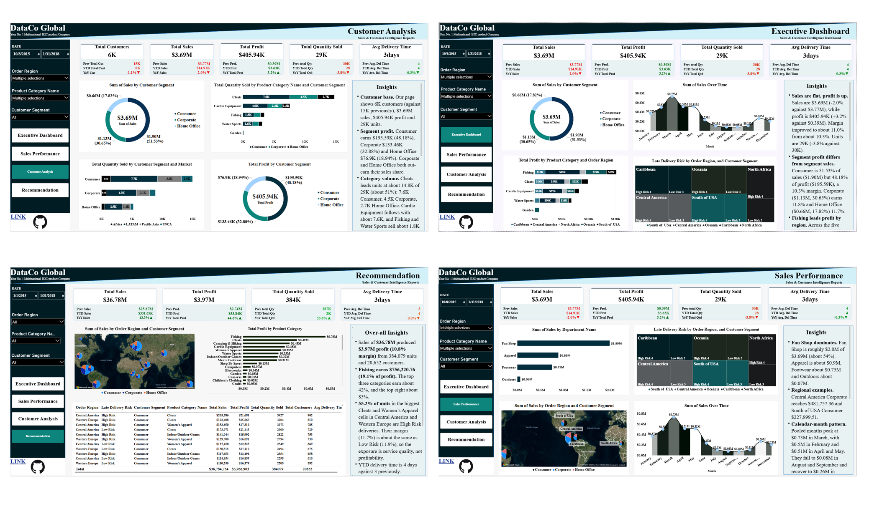

# DataCo Global: Sales & Customer Intelligence Dashboard

Which categories, regions and customer segments generate DataCo Global's profit, how much of that profit is exposed to late-delivery risk, and where should management concentrate investment to sustain growth without eroding margin?

  
**Project resources:** [Live Dashboard](https://geopulse-retail-analytics.streamlit.app/) | [Project Brief](docs/project_brief.md) | [Project Insights and Recommedation](docs/insights_recommendation.md)

---

## Executive Summary

Across the full reporting window (1 Jan 2015 to 31 Jan 2018), DataCo Global recorded **$36.78M in sales** ($36,784,734), **$3.97M in profit** ($3,966,903, a **10.8% net margin**), **384,079 units** and **20,652 customers**. That works out to about **$1,781 in sales, $192 in profit and 18.6 units per customer**, and **$95.78 revenue and $10.33 profit per unit**.

Recommendation page reports growth of **+43.3% in sales, +44.6% in profit and +33.6% in units** against the prior period ($25.67M, $2.74M and 287K units). Sales grew about 10 points faster than volume, so revenue per unit rose from about $89.44 to $95.78 (+7%). Margin was essentially flat (10.7% to 10.8%).

Three findings shape the recommendations:

1. **Profit is concentrated in a few categories.** Fishing earns **$756,220.76 (19.1% of profit)**. The top three categories (Fishing, Cleats at $0.49M, Camping & Hiking at $0.43M) earn about **42%**, and the top eight about **85%**. Six tail categories (Computers, Electronics, Garden, Cameras, Children's Clothing, Crafts) together earn only about **$0.23M (5.8%)**.
2. **Delivery risk affects over half of volume in the biggest cells.** In the four largest Cleats and Women's Apparel cells for Central America and Western Europe, **55.2% of units** are classed High Risk. High-risk orders deliver in 4 days against 3 for low-risk, yet earn the same margin (11.7% against 11.9%). The exposure is to service quality and repeat purchase, not to unit profitability.
3. **Segment margins depend on region mix.** In the five-region view, Consumer earns the lowest margin (10.3%) against Corporate (11.8%) and Home Office (11.7%). Any segment pricing action should be region-specific.

---

## Business Context

DataCo Global is a multinational B2C company with a rapidly growing customer base and a wide product portfolio. Executives want to understand:

- sales performance over time
- profit contribution by region and category
- customer segmentation and regional trends

This repository holds the analytical model, the four-page Power BI report and the documentation behind it.

## Objectives

1. Turn raw order data into a clean, consistent analytical model.
2. Report total, prior-period and YTD performance for sales, profit, quantity, customers and delivery time.
3. Quantify profit contribution by **category**, **region** and **customer segment**.
4. Measure delivery performance and late-delivery risk by region and category.
5. Convert findings into prioritised, number-backed recommendations.

## Data Overview

The analysis is built on a single order-level extract of **180,520 rows and 50 columns**, covering **1 Jan 2015 to 31 Jan 2018**. Each row is one order line, so an order with several products appears on several rows. This is why the extract holds 180,520 rows against **384,079 units sold** (about 2.1 units per row) and **20,652 distinct customers** (about 8.7 order lines per customer).

Definitions are in [`docs/data_dictionary.md`](docs/data_dictionary.md). Measure logic is in [`docs/dax_measures.md`](docs/dax_measures.md).

## Data Model (Star Schema)

The model follows a **star schema**: one central fact table at order-line grain, surrounded by dimension tables that describe who, what, where, when and how. Every dimension relates to the fact table one-to-many, with filters flowing from the dimension to the fact.

**Why a star schema.**
- **Time intelligence needs a proper date table.** `DATESYTD` and `SAMEPERIODLASTYEAR` only work on a continuous, marked date table. `Dim_Date` should run from 1 Jan 2014 to 31 Dec 2018 so that prior-year comparisons exist for the first months of 2015.
- **One slicer filters every visual.** Order Region, Product Category and Customer Segment each live in one place, so the same selection flows to all four pages.
- **Customer counts come from the right grain.** Counting distinct Customer Id in the fact table gives 20,652 buyers, while a row count would give 180,520. Because it respects date filters, it also gives the correct count for YTD and prior-year windows.
- **A lighter, faster model.** Of the 50 source columns, only the fields the report needs are loaded, and repeated text attributes sit in small dimensions rather than 180,520 times in the fact table.

## Key Findings

**1. Profitability and unit economics.** Margin is 10.8% ($3.97M on $36.78M). The prior period earned 10.7% ($2.74M on $25.67M). Revenue per unit is up about 7%, which points to a price and mix lift on top of volume growth.

**2. Profit concentration by category.** Profit by category, from the Recommendation page:

| Category | Profit | Share of total |
|---|---|---|
| Fishing | $0.76M ($756,220.76) | 19.1% |
| Cleats | $0.49M | 12.3% |
| Camping & Hiking | $0.43M | 10.8% |
| Cardio Equipment | $0.38M | 9.6% |
| Women's Apparel | $0.35M | 8.8% |
| Water Sports | $0.33M | 8.3% |
| Indoor/Outdoor Games | $0.32M | 8.1% |
| Men's Footwear | $0.31M | 7.8% |
| Shop By Sport | $0.13M | 3.3% |
| Computers, Electronics, Garden, Cameras, Children's Clothing, Crafts | $0.23M combined | 5.8% |

Labels are rounded to $0.01M, and the remaining profit sits in smaller categories not labelled on the chart.

**3. Largest region-category cells.** Cleats in Central America (High Risk) leads with $205,586 sales, $21,681 profit and 902 customers. Cleats in Western Europe (High Risk) follows with $193,408 sales and $25,663 profit (13.3% margin). Women's Apparel and Indoor/Outdoor Games complete the top cells in both regions.

**4. Delivery risk is a service problem, not a margin problem.** In the four complete Cleats and Women's Apparel cells (Central America and Western Europe):

| Risk class | Sales | Profit | Margin | Units |
|---|---|---|---|---|
| High Risk | $692,344 | $80,745 | 11.7% | 12,498 (55.2%) |
| Low Risk | $562,486 | $66,955 | 11.9% | 10,148 (44.8%) |

Average delivery is 3 days overall, but YTD is 4 days, and High Risk deliveries average 4 days against 3 for Low Risk.

**5. Segment mix and margin in the five-region view** (Caribbean, Central America, North Africa, Oceania, South of USA; $3.69M sales, $405.94K profit):

| Segment | Sales | Share | Profit | Share | Margin |
|---|---|---|---|---|---|
| Consumer | $1.90M | 51.53% | $195.59K | 48.18% | 10.3% |
| Corporate | $1.13M | 30.65% | $133.46K | 32.88% | 11.8% |
| Home Office | $0.66M | 17.82% | $76.9K | 18.94% | 11.7% |

Consumer's profit-to-sales index is 0.93, against 1.07 for Corporate and 1.06 for Home Office. Cleats is the volume leader in this view, at about 14.8K of 29K units (about 51%).

**6. Department and regional sales.** Fan Shop leads departments at roughly $2.0M (about 54% of the $3.69M), then Apparel (about $0.9M), Footwear (about $0.75M) and Outdoors (about $0.07M). Central America Corporate reaches $481,757.36 and South of USA Consumer $227,999.51.

**7. Growth is uneven.** The full-window view shows +43.3% sales growth. The five-region view shows -2.0% in sales ($3.69M against $3.77M), +3.2% in profit and -3.8% in units, so margin improved from about 10.3% to 11.0%. Pooled by calendar month, sales in that view peak at $0.73M in March and trough at $0.08M in August and September. Because the chart has no year axis, this is not a true seasonality measure.

## Recommendations

| # | Recommendation | Evidence | Indicative impact |
|---|---|---|---|
| 1 | **Anchor investment on the profit core.** Prioritise stock, marketing and service for Fishing, Cleats and Camping & Hiking. | These three earn about 42% of profit. Fishing alone is 19.1%. | Protects nearly half of profit |
| 2 | **Run a delivery-reliability programme in Central America and Western Europe.** Review carriers and ship modes for Cleats, Women's Apparel and Indoor/Outdoor Games, and set a late-delivery-rate target. | 55.2% of units in the top cells are High Risk. YTD delivery is 4 days against 3. | Protects the highest-value customer base |
| 3 | **Rationalise the tail.** Review pricing, range and shelf space for Computers, Electronics, Garden, Cameras, Children's Clothing and Crafts. | Six categories earn about $0.23M (5.8%). | Simpler range and freed working capital |
| 4 | **Correct Consumer pricing in the five-region view.** Review discount depth and bundles for Consumer. | Consumer margin 10.3% against 11.8% for Corporate. | About +1.5 pp on $1.90M, roughly $28K profit |
| 5 | **Build customer-value cohorts.** Segment the 20,652 customers by sales, profit and purchase frequency. | Average customer is worth $1,781 in sales and $192 in profit. | Targets retention and cross-sell spend |

## Page Report

| Page | Purpose |
|---|---|
| Executive Dashboard | Headline KPIs, sales by segment, monthly sales, profit by category and region, delivery risk |
| Sales Performance | Sales by department, delivery risk by region, sales map and monthly trend |
| Customer Analysis | Customers, sales and profit by segment, units by category and by market |
| Recommendation | Full-window KPIs, sales map, profit by category, detail table (region, risk, segment, category) and the insights panel |

## Data Quality Notes and Limitations

- The Executive, Sales and Customer pages share one filter set (from 8 Oct 2015, five regions, selected categories) that differs from the Recommendation page (full window, All). The first three therefore show $3.69M, about 10% of the $36.78M total. Full-window headline figures come from the Recommendation page.
- Growth percentages are as reported. The measures compare the selected window with a shifted window, so they are being re-based to like-for-like YTD against prior-year YTD.

## Tools

* Microsoft Power BI Desktop ( For data upload and analysis )
* Power Query ( For data cleaning and validation)
* Model ( For Data Relationship development and management)

## Project Resources

- **Live Dashboard:** [View the live Reports](assets/Excel_WorkBook.xlsx)
- **Project Report:** [Project Insights and Recommedation](docs/insights_recommendation.md)
- **Project Brief:** [Read the project brief](docs/project_brief.md)
  

## Contact

Lawrence Ruth: lawrenceruth34@gmail.com · [LinkedIn](https://www.linkedin.com/in/ruth-lawrence-8519073b7) · [GitHub](https://github.com/lawrenceruth)

*DataCo Global: Sales & Customer Intelligence is a portfolio project for learning and demonstration from LeadHer Foundation Instistute. Its results should not be read as commercial evidence.*

## Author

Ruth Lawrence, Junior Data Analyst.
